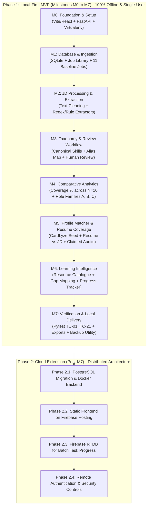

# JPMorgan Career Intelligence (JCI) - Implementation Roadmap & Sequential Phases

**Version 1.2 | 17 November 2026**

This document serves as the master implementation reference for the **JPMorgan Career Intelligence (JCI)** platform. It details the sequential execution phases, technical specifications, prerequisites, tasks, file deliverables, and acceptance verification criteria.

---

## Architectural Strategy: Two-Phase Delivery



---

## Phase 1: Local-First MVP Implementation

### Phase 1.0 (Milestone M0): Foundation, Scaffolding & Environment Setup

#### 1. Objective
Establish the local development environment, project repository structure, backend and frontend boilerplates, and automated development workflows with zero cloud dependencies.

#### 2. Prerequisites & Tools
- Python 3.12+ installed locally.
- Node.js 18+ and `npm` installed locally.
- Git repository configured with strict `.gitignore` rules.

#### 3. Step-by-Step Implementation Tasks
1. **Repository Layout:** Create the standardized folder structure:
   ```text
   JP_Morgan_Career_Intelligence/
   ├── .docs/                 # Authoritative project specifications & datasets
   ├── backend/               # Python FastAPI backend
   │   ├── app/
   │   │   ├── api/           # REST routers (jobs, extraction, analytics, profile, learning)
   │   │   ├── core/          # Configuration, constants, database setup
   │   │   ├── models/        # SQLAlchemy ORM / Pydantic schema models
   │   │   ├── services/      # Business logic (parsers, normalizers, matchers)
   │   │   └── data/          # Seed datasets (taxonomy, aliases, sample resources)
   │   ├── tests/             # Pytest automated test suite (TC-01 to TC-21)
   │   ├── requirements.txt   # Pinned Python dependencies
   │   └── run.py             # Local development server entrypoint
   ├── frontend/              # React web client (Vite + TypeScript + Tailwind)
   │   ├── src/
   │   │   ├── components/    # Reusable UI components (tables, badges, modal, alerts)
   │   │   ├── pages/         # Dashboard, JobLibrary, ReviewScreen, Profile, Learning
   │   │   ├── services/      # Axios / Fetch API client modules
   │   │   └── types/         # TypeScript interfaces matching backend models
   │   ├── package.json
   │   └── vite.config.ts
   ├── uploads/               # Local private uploads folder (git-ignored)
   ├── data/                  # Local SQLite database storage (git-ignored)
   ├── phases.md              # Implementation master plan
   └── README.md              # Project summary and documentation index
   ```
2. **Backend Setup:**
   - Initialize Python virtual environment (`python -m venv venv`).
   - Create `backend/requirements.txt` with: `fastapi`, `uvicorn[standard]`, `pydantic>=2.0`, `sqlalchemy`, `pymupdf`, `python-docx`, `pandas`, `openpyxl`, `pytest`, `pytest-asyncio`, `python-multipart`.
   - Create basic FastAPI application in `backend/app/main.py` with health-check endpoint (`GET /api/health`).
3. **Frontend Setup:**
   - Scaffold React application with Vite (`npm create vite@latest frontend -- --template react-ts`).
   - Install Tailwind CSS and Lucide icons (`lucide-react`).
   - Configure proxy in `vite.config.ts` to forward `/api` requests to `http://localhost:8000`.
4. **Security & Privacy Audit:**
   - Create root `.gitignore` ensuring that `venv/`, `node_modules/`, `data/*.db`, `uploads/`, `*.log`, and `.env` are strictly excluded from source control (NFR-05).

#### 4. Verification Checkpoint
- Backend runs via `python run.py` and returns `{"status": "healthy"}` on `http://localhost:8000/api/health`.
- Frontend runs via `npm run dev` and renders initial dashboard layout in browser.
- Git status confirms all runtime data directories are untracked.

---

### Phase 1.1 (Milestone M1): Local Relational Database & Job Ingestion

#### 1. Objective
Build the local SQLite relational persistence layer, implement job ingestion via paste and document upload (PDF/DOCX), preserve immutable raw text, and populate the library with the 11 baseline JPMorgan Chase job listings.

#### 2. Prerequisites
- Phase 1.0 completed and running.

#### 3. Step-by-Step Implementation Tasks
1. **Database Schema Design (`backend/app/models/`):**
   - Implement SQLAlchemy models and SQLite connection in `backend/app/core/database.py`:
     - `Company`: `id`, `name`.
     - `JobListing`: `id`, `company_id`, `title`, `external_job_id`, `location`, `source_url`, `capture_date`, `role_family` (`Family A`, `Family B`, `Family C`), `status` (`Available`, `JD unavailable`, `Stale`, `Archived`), `original_description` (immutable text), `cleaned_description` (nullable text), `created_at`, `updated_at`.
     - Add unique constraint on `(company_id, external_job_id)`.
2. **Document Extraction Service (`backend/app/services/document_parser.py`):**
   - Integrate `pymupdf` (PyMuPDF) to extract clean text from uploaded PDF files (FR-02).
   - Integrate `python-docx` to extract text from DOCX files.
   - Enforce validation: reject unsupported mimetypes, empty files, or corrupted archives (TC-04, TC-05).
3. **Ingestion API Endpoints (`backend/app/api/jobs.py`):**
   - `POST /api/jobs`: Manual job entry with required fields: company, title, role family, and description (unless status is `JD unavailable`) (FR-01, BR-01).
   - `POST /api/jobs/upload`: Ingest via PDF/DOCX file upload with text preview (FR-02).
   - `GET /api/jobs`: Retrieve all jobs with query filters for `role_family`, `status`, `location`, and title search (FR-04).
   - `GET /api/jobs/{id}`: Detailed view of job record including immutable original description (FR-03).
   - `PUT /api/jobs/{id}`: Edit job metadata and description with last-modified timestamp (FR-05).
   - `DELETE /api/jobs/{id}`: Delete job and linked dependent entities with confirmation (FR-06).
4. **Baseline Dataset Seeding Script (`backend/app/core/seed.py`):**
   - Author a seeding script that automatically parses `.docs/Job_Listings.md` and populates the SQLite database with all 11 JPMorgan Chase baseline roles:
     - 10 roles populated with full text and status `Available`.
     - Job 6 (*JPMorgan Data Governance – Senior Associate*) populated with metadata, `role_family = 'Family A'`, and status `JD unavailable` (TC-07).
5. **Frontend Job Library Screen (`frontend/src/pages/JobLibrary.tsx`):**
   - Table view showing title, role family badge, location, status badge, capture date.
   - Filter bar: Role Family dropdown (`All`, `Family A`, `Family B`, `Family C`), Status filter, text search.
   - Add Job Modal: Tabs for "Paste Text" and "Upload Document (PDF/DOCX)" with live preview before saving.
   - Job Detail drawer / page displaying immutable original text.
6. **Web-Based SQL Database Console & Inspection Tooling (FR-41):**
   - Provide an interactive, web-based SQLite database console running alongside the application (using `sqlite-web` or an embedded FastAPI database explorer endpoint) accessible at `http://localhost:8080` (or via an "Open DB Console" link in the React app navbar):
     - **Firebase Console-like Experience:** Browse all database tables (`companies`, `job_listings`, `job_requirements`, `skills`, `profile_evidence`, etc.) in a clean web UI.
     - **Schema & Data Exploration:** View table schemas, field data types, foreign key relations, and raw row values in real time.
     - **Query Runner & Filters:** Filter, search, and sort records, or execute ad-hoc SQL queries with instant tabular output.
   - Provide a convenient one-command helper script (`backend/scripts/view_db.py` or `npm run db:console`).
   - Document zero-setup desktop GUI alternatives (DB Browser for SQLite, VS Code "SQLite Viewer" extension) pointing to `data/jci_local.db`.

#### 4. Verification Checkpoint
- `pytest tests/test_ingestion.py` passes (covering TC-01, TC-02, TC-03, TC-04, TC-05, TC-06, TC-07).
- Database contains 11 records; restarting application confirms all 11 records persist intact (TC-17, NFR-04).
- Launching the database console opens a browser tab displaying all tables and showing the seeded job records live, replicating the Firebase Console data-browsing experience.

---

### Phase 1.2 (Milestone M2): Job Description Processing & Deterministic Extraction

#### 1. Objective
Develop the text cleaning pipeline and rule-based deterministic extraction service to identify experience, qualifications, responsibilities, and preliminary skill mentions without external AI dependencies.

#### 2. Prerequisites
- Phase 1.1 completed with baseline jobs in SQLite.

#### 3. Step-by-Step Implementation Tasks
1. **Text Normalization Engine (`backend/app/services/text_cleaner.py`):**
   - Clean whitespace, strip non-printable unicode characters, remove page header/footer fragments, normalize bullet glyphs, and segment into sentences and paragraphs (FR-07).
   - Preserve clean copy in `cleaned_description` while leaving `original_description` untouched (FR-03).
2. **Extraction Engine (`backend/app/services/extractor.py`):**
   - **Experience Extractor (FR-08):** Regex patterns detecting explicit experience phrases (e.g. `(\d+)\+?\s*years?`, `minimum of (\d+) years`). Stores extracted numerical bounds, exact sentence snippet, and review status.
   - **Qualifications Extractor (FR-09):** Detects bachelor's, master's, postgraduate degrees, CFA, CA, MBA, and certifications. Flags formal degree prerequisites for education gap routing.
   - **Responsibility Extractor (FR-10):** Segments bulleted responsibility lists under headers (`Job responsibilities`, `Key Responsibilities`) and groups them into functional themes.
   - **Preliminary Skill Mentions (FR-11):** Dictionary matching against clean text; records verbatim text coordinate snippets.
   - **Requirement Type Classifier (FR-12):** Distinguishes required vs. preferred based on section context (`Required qualifications...` vs. `Preferred / Nice-to-Have`) or modal verbs (`must have`, `required`, `preferred`, `plus`).
3. **Database Entities:**
   - `JobRequirement`: `id`, `job_id`, `category` (experience, education, responsibility, skill), `raw_text`, `requirement_type` (`required`, `preferred`, `unspecified`), `evidence_snippet`, `review_status` (`Proposed`, `Accepted`, `Rejected`, `Edited`).
4. **Extraction API Endpoints (`backend/app/api/extraction.py`):**
   - `POST /api/jobs/{id}/extract`: Execute extraction pipeline for a job.
   - `GET /api/jobs/{id}/requirements`: Retrieve structured candidate extractions.
5. **Frontend Review Workspace (`frontend/src/pages/JobReview.tsx`):**
   - Side-by-side view: original description on left, extracted requirements with highlighted source snippets on right.

#### 4. Verification Checkpoint
- Deterministic extraction executes in <500ms per JD without network access (FR-28, NFR-08).
- `pytest tests/test_extraction.py` passes (TC-08).

---

### Phase 1.3 (Milestone M3): Canonical Skill Taxonomy, Alias Engine & Human Review

#### 1. Objective
Establish the controlled canonical skill taxonomy, alias resolution engine, and interactive human-in-the-loop review interface to ensure data quality and repeatable analytics.

#### 2. Prerequisites
- Phase 1.2 completed.

#### 3. Step-by-Step Implementation Tasks
1. **Taxonomy & Alias Data Model (`backend/app/models/`):**
   - `Skill`: `id`, `canonical_name`, `category` (`technical`, `finance_domain`, `data_tools`, `governance`, `competency`), `description`.
   - `SkillAlias`: `id`, `skill_id`, `alias_text` (unique, lowercase).
   - `JobSkill`: `id`, `job_id`, `skill_id`, `requirement_type` (`required`, `preferred`, `unspecified`), `evidence_snippet`, `extraction_method` (`dictionary`, `contextual_rule`, `manual`), `review_status` (`Proposed`, `Accepted`, `Rejected`, `Edited`).
2. **Taxonomy Baseline Seeding (`backend/app/data/taxonomy.json`):**
   - Seed core skills from the 10 analysable JDs:
     - *Technical:* Python, SQL, T-SQL, PySpark, Machine Learning, NLP, Generative AI, LLMs.
     - *Data & BI Tools:* Tableau, Power BI, Alteryx, Informatica, Collibra, Databricks, Snowflake, Qlik, Sigma, Excel.
     - *Governance & Quality:* Data Governance, Metadata Management, Data Quality Profiling, Data Lineage, Anomaly Detection, Reconciliation Controls.
     - *Finance & Operations:* FP&A, GAAP, IFRS, Variance Analysis, Credit Risk Analysis, Counterparty Due Diligence, Portfolio Stress Testing, Reference Data Operations, Corporate Payments, Cash Management.
     - *Competencies:* Stakeholder Communication, Cross-Functional Leadership, Problem Solving.
   - Seed alias maps (e.g. `postgres`, `postgresql`, `t-sql` $\rightarrow$ `SQL`; `powerbi`, `power bi desktop` $\rightarrow$ `Power BI`).
3. **Alias Normalization Engine (`backend/app/services/taxonomy_service.py`):**
   - Normalizes incoming skill phrases against `SkillAlias`.
   - Resolves known aliases to canonical skills (FR-13, BR-04, TC-09).
   - Unmapped or ambiguous terms are flagged as `Unresolved Candidate` for human review rather than guessing (TC-10).
4. **Human Review Workflow API (`backend/app/api/review.py`):**
   - `PUT /api/jobs/{id}/skills/{job_skill_id}`: Accept, edit, reclassify, or reject extracted skill links (FR-14, TC-13).
   - `POST /api/taxonomy/aliases`: Allow user to map an unresolved phrase to an existing canonical skill.
5. **Frontend Review Component:**
   - Interactive badge list grouped by category.
   - User can click a badge to inspect exact evidence snippet, change requirement type (Required/Preferred), or delete spurious detections.

#### 4. Verification Checkpoint
- Mapping verified aliases resolves synonyms into a single canonical skill count (TC-09).
- Ambiguous terms are presented for user review (TC-10).
- User edits persist across application restarts (TC-13, TC-17).

---

### Phase 1.4 (Milestone M4): Comparative Analytics Engine & Dashboard

#### 1. Objective
Build the mathematical comparative analytics engine to calculate distinct-job skill coverage across the 10 analysable listings, separate required vs. preferred mentions, and render role-family comparisons.

#### 2. Prerequisites
- Phase 1.3 completed with reviewed job skills in SQLite.

#### 3. Step-by-Step Implementation Tasks
1. **Analytics Engine Service (`backend/app/services/analytics_service.py`):**
   - Implement distinct-job coverage calculation (FR-15, BR-06, BR-07):
     $$\text{Coverage}(\%) = \left( \frac{\text{Count of Distinct Jobs Mentioning Skill}}{N} \right) \times 100$$
   - Enforce active denominator rule: $N$ is strictly the count of selected jobs with status `Available` ($N = 10$ for full dataset); listings with status `JD unavailable` are excluded from the denominator.
   - Enforce single-count constraint: a skill mentioned multiple times in one JD contributes exactly 1 to that job's count (BR-07, TC-11).
   - Separate calculations for required mentions, preferred mentions, and total mentions.
2. **Role Family Filtering & Matrix Engine (FR-16):**
   - Filter calculations by Role Family:
     - `Family A` (Data Management, Quality & Governance)
     - `Family B` (Analytics, Automation & AI)
     - `Family C` (Finance, Credit & Operations)
   - Cross-role skill comparison matrix: rows = canonical skills, columns = role families or specific jobs, cells = required / preferred indicators.
3. **Analytics API Endpoints (`backend/app/api/analytics.py`):**
   - `GET /api/analytics/overview`: Total jobs, analysable count ($N$), unavailable count, role family distribution, top skills.
   - `GET /api/analytics/coverage`: Paginated/sorted skill coverage table with required/preferred counts.
   - `GET /api/analytics/matrix`: Role-family comparative matrix.
4. **Frontend Analytics Dashboard (`frontend/src/pages/Dashboard.tsx`):**
   - Summary stat cards: Analysable Jobs ($N=10$), Total Canonical Skills, Role Families (3).
   - Horizontal bar chart of top recurring skills with required vs. preferred segmenting.
   - Interactive Role Comparison table with column filters for Families A, B, and C.
   - Click-to-inspect modal displaying the exact JD snippets contributing to any skill bar.

#### 4. Verification Checkpoint
- Skill coverage counts and percentages match the hand-tallied baseline across the 10 analysable JDs (TC-11).
- Filtering to a specific role family recalculates $N$ and coverage correctly for that subset (TC-12).

---

### Phase 1.5 (Milestone M5): Profile Matcher, CardLyze Seed & Resume Keyword Coverage

#### 1. Objective
Implement the evidence-based profile matcher with verified contribution attribution, pre-seed the user profile with the CardLyze project baseline, enforce education vs. skill gap isolation, and build the **Resume Keyword Coverage** feature (FR-37 to FR-40).

#### 2. Prerequisites
- Phase 1.4 completed.

#### 3. Step-by-Step Implementation Tasks

#### Sub-phase 1.5A: Profile Matcher & CardLyze Seed
1. **Profile Data Model (`backend/app/models/`):**
   - `UserProfile`: `id`, `full_name`, `summary`.
   - `ProfileEvidence`: `id`, `user_id`, `skill_id`, `evidence_status` (`Demonstrated`, `Partial`, `Learning`, `Not demonstrated`), `contribution_type` (`independent`, `ai_assisted`, `supervised`, `collaborative`), `project_name`, `description`, `date_recorded`.
2. **CardLyze Profile Seeding Script (`backend/app/core/seed_profile.py`):**
   - Automatically pre-seed the user's profile with the CardLyze project attribution per FR-19:
     - *Independent contributions:* TMS-ATM requirements analysis, provider data dictionaries, `Card_Data.ipynb` exploratory data analysis, AWS RDS environment specifications.
     - *AI-assisted contributions:* Rule engine, report engine, alert ledger, scheduler, S3/database adapters, T-SQL scripts, UI dashboard, Docker configuration, automated tests.
     - Sets corresponding skills: T-SQL, Python, Docker marked with AI-assisted attribution; requirements and data dictionary domain analysis marked Demonstrated.
3. **Multi-Dimensional Matching Engine (`backend/app/services/matcher_service.py`):**
   - Evaluates a target JD against profile evidence across discrete dimensions:
     - Technical alignment, functional alignment, domain alignment, experience alignment, education alignment, and evidence strength (FR-20, FR-21).
   - **Education vs. Skill Gap Isolation (BR-15, TC-21):** Formal education prerequisites (specifically the Reference Data Analyst role's postgraduate finance degree) are evaluated strictly under the Education dimension and never scored as a technical skill gap.

#### Sub-phase 1.5B: Resume Keyword Coverage (New Feature)
4. **Resume Ingestion & Parse Check (FR-37, FR-39):**
   - Data entity: `ResumeDocument` (`id`, `user_id`, `source_type`, `raw_text`, `parse_status`, `capture_date`, `file_path`).
   - Implement `POST /api/profile/resume`: accepts pasted text or PDF/DOCX file upload.
   - Text parser runs parse check heuristics (FR-39):
     - Check for empty extraction buffer.
     - Check for scrambled multi-column text (unusually short line fragments, high whitespace-to-char ratio).
     - Returns parse warning alert if extraction looks flawed.
   - Stores raw resume text in SQLite; saves binary to local `uploads/` folder if file retention enabled.
5. **Resume vs. JD Keyword Coverage Engine (FR-38, BR-13, BR-14):**
   - Implement `GET /api/profile/resume/coverage/{job_id}`:
     - Scans resume text against all canonical skills and aliases required or preferred by the selected JD (BR-14).
     - Finds the exact matching line/bullet from the resume and the exact matching line from the JD.
     - Generates line-by-line coverage comparison without any composite percentage score (FR-38).
6. **Claimed but Unsupported Evidence Audit (FR-40, BR-13):**
   - Cross-references all skills detected in the resume against `ProfileEvidence`.
   - If a skill is mentioned in the resume but has no supporting project evidence in the profile, flag as:
     `Claimed in resume, unsupported by profile evidence` (TC-20).
   - Enforce rule BR-13: resume keyword mention does not automatically upgrade evidence status to Demonstrated.
7. **Frontend Profile & Resume Workspace (`frontend/src/pages/ProfileMatcher.tsx`):**
   - Profile tab: View/edit education, work history, projects (CardLyze), and evidence claims with contribution badges.
   - Resume tab: Upload/paste resume, view parse check alerts, select target JD from dropdown.
   - Coverage view: Side-by-side snippet comparison showing JD requirement line vs. resume matching line, with "Claimed but unsupported" status pills.

#### 4. Verification Checkpoint
- CardLyze project loads with verified attribution (TC-15).
- Reference Data Analyst role flags postgraduate finance qualification strictly as an education gap (TC-21).
- Resume coverage displays matching lines for JD skills with zero composite score (TC-19).
- Resume skills without profile deliverables are flagged as claimed but unsupported (TC-20).

---

### Phase 1.6 (Milestone M6): Learning Intelligence, Gap Mapping & Tracking

#### 1. Objective
Build the vetted learning resource catalogue, map identified gaps to specific resources, and track user study progress without inflating proficiency claims.

#### 2. Prerequisites
- Phase 1.5 completed with gap analysis operational.

#### 3. Step-by-Step Implementation Tasks
1. **Learning Data Model (`backend/app/models/`):**
   - `LearningResource`: `id`, `provider` (Coursera, edX, Forage, documentation), `title`, `url`, `cost_status` (`Free`, `Paid`, `Freemium`, `Unknown`), `certificate_flag`, `duration_hours`, `skill_id`, `verification_date`.
   - `LearningProgress`: `id`, `user_id`, `resource_id`, `status` (`Not started`, `In progress`, `Completed`, `Paused`), `start_date`, `completion_date`, `notes`.
2. **Resource Catalogue Seeding (`backend/app/data/learning_resources.json`):**
   - Seed verified resources mapped to common gaps identified in JCI Plan Review:
     - *SQL depth:* Advanced SQL window functions and query optimization courses.
     - *Data Quality & Controls:* Data quality profiling and reconciliation modules.
     - *BI Tools:* Power BI / Tableau dashboard construction labs.
     - *AI Enablement:* LLM workflow automation and Python NLP courses.
     - *Enterprise Tools:* Alteryx tutorials, Collibra/Informatica governance overviews.
3. **Recommendation Engine (`backend/app/services/learning_service.py`):**
   - For any job or role family, queries unfulfilled or partial skills and maps them to catalogued resources (FR-23, BR-10).
   - Labels unverified or stale cost statuses as `Unknown` (BR-11).
4. **Progress Tracker Workflow (FR-24, BR-09):**
   - `PUT /api/learning/progress/{resource_id}`: Update progress state, dates, and notes.
   - Enforce rule BR-09: marking a course as Completed updates learning progress, but does NOT automatically change profile evidence status to Demonstrated (TC-14).
5. **Frontend Learning Tracker Screen (`frontend/src/pages/LearningTracker.tsx`):**
   - Recommended resources cards organized by priority gap.
   - Active learning board (Kanban / tabular) with status toggles and notes modal.

#### 4. Verification Checkpoint
- Recommendations cite the exact gap they address (BR-10).
- Course completion does not auto-upgrade skill proficiency (TC-14).

---

### Phase 1.7 (Milestone M7): Validation Test Suite, Exports & Local Delivery

#### 1. Objective
Complete automated test coverage for all 21 test scenarios (TC-01 through TC-21), implement CSV/Excel export functionality, provide database backup/restore utilities, and execute a privacy audit.

#### 2. Prerequisites
- Phases 1.0 through 1.6 completed.

#### 3. Step-by-Step Implementation Tasks
1. **Comprehensive Test Suite (`backend/tests/`):**
   - Implement complete automated tests verifying:
     - Ingestion: TC-01 (paste), TC-02 (PDF), TC-03 (DOCX), TC-04 (bad file), TC-05 (empty text), TC-06 (duplicate job ID), TC-07 (unavailable JD).
     - Extraction & Normalization: TC-08 (deterministic extraction), TC-09 (approved alias), TC-10 (ambiguous alias), TC-11 (multi-job distinct count), TC-12 (role family filter), TC-13 (review edit persistence).
     - Profile & Matching: TC-14 (course completion non-upgrade), TC-15 (CardLyze attribution), TC-16 (offline engine without AI key), TC-17 (restart persistence), TC-18 (export accuracy).
     - New Requirements: TC-19 (resume coverage), TC-20 (claimed unsupported skill), TC-21 (Reference Data education gap).
2. **Export Engine (`backend/app/services/export_service.py`):**
   - Export active job library, skill coverage tables, cross-role matrix, and resume coverage comparisons to CSV and formatted Excel (`.xlsx` via `openpyxl`) (FR-26, TC-18).
3. **Database Backup & Recovery Utility:**
   - Create `backend/scripts/backup_db.py`: dumps timestamped copy of `jci_local.db` to private `backups/` folder.
   - Create `backend/scripts/restore_db.py`: safely restores database with integrity check (NFR-09).
4. **Final Privacy & Security Audit:**
   - Verify that all `.db` files, `uploads/`, `backups/`, and temporary export files are git-ignored and contain no hardcoded secrets (NFR-05).

#### 4. Verification Checkpoint
- `pytest tests/` runs 21/21 test cases and passes with 100% success rate.
- Backup and restore utility verified with test database snapshot.
- Phase 1 Local-First MVP is production-ready for offline single-user operation.

---

## Phase 2: Cloud Deployment & Firebase Architecture (Post-M7 Extension)

> [!NOTE]
> **Scope boundary:** Phase 2 is an independent cloud extension scheduled after Phase 1 delivery. It addresses requirements FR-29 through FR-36 (assigned release priority "Later").

### Phase 2.1: FastAPI Containerization & PostgreSQL Migration
1. **Containerization:** Create `backend/Dockerfile` and `docker-compose.yml` using `python:3.12-slim` and production ASGI server (`uvicorn` with multiple workers).
2. **Database Engine Migration (FR-31):**
   - Implement SQLAlchemy database URL switching via environment variables (`DATABASE_URL`).
   - Create Alembic migration scripts to port schema from SQLite to managed PostgreSQL.

### Phase 2.2: Frontend Cloud Hosting via Firebase Hosting (FR-29, FR-35)
1. **Production Build:** Configure Vite production build output to `frontend/dist`.
2. **Firebase Hosting Configuration:** Configure `firebase.json` with SSL termination, global CDN caching, and SPA routing rewrites.
3. **Environment Separation:** Configure frontend API base URL via `VITE_API_BASE_URL` pointing to the deployed FastAPI cloud service.

### Phase 2.3: Firebase Realtime Database (RTDB) Integration (FR-32, FR-33, FR-34)
1. **Status Publisher:** Configure server-side Firebase Admin SDK on FastAPI to publish transient progress states (`queued`, `processing`, `completed`, `failed`) for long-running batch extraction tasks.
2. **Frontend Live Subscription:** Frontend subscribes to narrow user status paths in RTDB to render live progress bars without polling PostgreSQL.
3. **Failure Isolation:** If RTDB is unreachable, the system falls back seamlessly to standard REST request/response without blocking core workflows (FR-34).

### Phase 2.4: Production Cloud Security & Authentication (FR-36)
1. **Authentication:** Implement Firebase Authentication for user sign-in.
2. **JWT Authorization:** FastAPI verifies Firebase ID tokens on private REST endpoints.
3. **CORS Hardening:** Restrict allowed CORS origins strictly to the authorized Firebase Hosting domain.
4. **Secret Management:** Manage PostgreSQL credentials and Firebase service-account private keys via cloud secret stores (e.g. Google Secret Manager); ensure zero secrets in frontend code.

---

## Phase Execution Checklist & Cross-Reference

| Phase | Milestone | Scope | Primary Files / Modules | Acceptance Criteria |
| --- | --- | --- | --- | --- |
| **Phase 1.0** | **M0** | Local Scaffolding | `backend/run.py`, `frontend/vite.config.ts`, `.gitignore` | Health check 200 OK; frontend renders; Git clean |
| **Phase 1.1** | **M1** | Ingestion, SQLite & DB Console | `models/job.py`, `services/document_parser.py`, `seed.py`, `scripts/view_db.py` | 11 jobs ingested (10 available, 1 unavailable); DB Console operational at `http://localhost:8080`; TC-01..07 pass |
| **Phase 1.2** | **M2** | Extraction Engine | `services/text_cleaner.py`, `services/extractor.py` | Deterministic extraction <500ms; TC-08 passes |
| **Phase 1.3** | **M3** | Taxonomy & Review | `services/taxonomy_service.py`, `ReviewScreen.tsx` | Synonyms normalized; edits persist; TC-09, 10, 13 pass |
| **Phase 1.4** | **M4** | Analytics Dashboard | `services/analytics_service.py`, `Dashboard.tsx` | Coverage % across N=10 correct; Families A/B/C filters; TC-11, 12 pass |
| **Phase 1.5** | **M5** | Profile & Resume | `services/matcher_service.py`, `services/resume_service.py` | CardLyze seeded; TC-15, 19, 20, 21 pass (FR-37..40, BR-13..15) |
| **Phase 1.6** | **M6** | Learning Tracker | `services/learning_service.py`, `LearningTracker.tsx` | Resources mapped to gaps; non-auto-upgrade; TC-14 passes |
| **Phase 1.7** | **M7** | Verification & Release | `tests/test_all.py`, `backup_db.py`, `export_service.py` | 21/21 Pytest pass; exports verified; offline delivery complete |
| **Phase 2.0** | **Post-M7** | Cloud & Firebase | `Dockerfile`, `firebase.json`, Alembic migrations | FR-29..36 satisfied; Firebase Hosting + PostgreSQL live |
