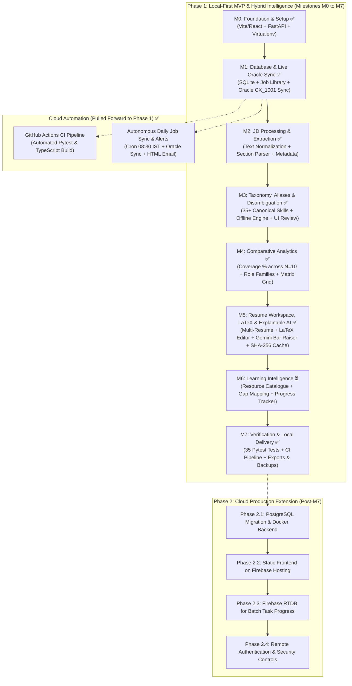

# JPMorgan Career Intelligence (JCI) - Implementation Roadmap & Sequential Phases

**Version 2.0 | November 2026**

This document serves as the master implementation reference for the **JPMorgan Career Intelligence (JCI)** platform. It details the sequential execution phases, technical specifications, prerequisites, tasks, file deliverables, acceptance verification criteria, and the updated system evolution status.

---

## 1. Architectural Strategy: Two-Phase Delivery & Hybrid Intelligence

### Low-Spec Hardware Optimization & Zero-RAM Cloud Inference Strategy
To ensure the application executes smoothly on resource-constrained development machines (such as 4.00 GB RAM with dual-core CPUs, e.g., Intel Core i5-6200U) without memory exhaustion (`MemoryError`) or disk thrashing:
1. **Lightweight Local Baseline (<150 MB RAM):** Text normalization, section parsing, exact keyword matching, and SQLite persistence run entirely in-process using Python standard libraries, PyMuPDF, and SQLAlchemy, maintaining an ultra-low memory footprint.
2. **Zero-RAM Semantic Cloud Intelligence (Option 2):** Heavy natural language understanding, ambiguous skill disambiguation, and qualitative resume feedback bypass local GPU/CPU hardware completely by routing through a free-tier external LLM adapter (Google Gemini 1.5 Flash).
3. **Graceful Offline Degradation:** If no API key is provided or the device is offline, all workflows automatically fall back to the deterministic canonical taxonomy engine with zero feature disruption.
4. **Anti-API Hoarding Architecture (Zero Cost Protection):**
   - **Persistent SQLite Caching (`LLMEvaluation`):** Evaluations are fingerprinted with SHA-256 hashes of `(resume_text + job_description)`. Re-visiting the same job/resume pair hits local SQLite with zero network calls.
   - **Manual User Triggers:** LLM evaluations are strictly user-initiated (via *"Re-Analyze with Gemini AI"*); browsing jobs or opening the app never auto-triggers API calls.
   - **Free Cloud Execution via GitHub Actions:** Daily job polling runs in the cloud on GitHub's free runners at 08:30 IST, avoiding sleeping cloud server limits (Render free tier) and zero server hosting bills.

---

## 2. System Status & Evolution Audit

Over the course of implementation, user requirements and practical constraints drove key design enhancements that elevated the platform beyond the original static design:

| Feature Dimension | Original Specification (v1.2) | Evolved Implementation (v2.0) | Status |
| :--- | :--- | :--- | :--- |
| **Job Data Source** | 11 static job descriptions seeded from `.docs/Job_Listings.md`. | Live integration with JPMorgan Chase Oracle Cloud Candidate Experience (`CX_1001`), supporting Goregaon/Mumbai filtering, auto-requisition IDs (`JPMC-REQ-XX`), and stale status tracking. | **Completed & Live** |
| **Posting Date Visibility** | Generic capture date defaulting to system ingestion time. | Preserves Oracle Cloud `PostedDate` / `ExternalPostedStartDate` and surfaces formatted posting dates across Dashboard, Resume Workspace, Job Library, and Email Alerts. | **Completed & Live** |
| **Resume Handling** | Single profile keyword matcher. | **Multi-Resume Repository** with PyMuPDF text extraction, live PDF byte-streaming preview, and an in-platform **syntax-highlighted LaTeX editor** with Overleaf export. | **Completed & Live** |
| **Matching Engine** | Simple keyword intersection count. | **Explainable AI Bar Raiser (Gemini Flash)** with 3-dimensional rubric (Technical 45%, Domain Governance 35%, Seniority 20%), detailed rationale, verified competencies, and critical gaps + **Offline Taxonomy Fallback**. | **Completed & Live** |
| **API Quota Safety** | Basic error handling if key missing. | SHA-256 fingerprint caching in SQLite (`llm_evaluations`), manual user-only triggers, and offline ranking for leaderboard and daily alerts. | **Completed & Live** |
| **Scheduled Automation** | Unspecified / planned for Phase 2. | **GitHub Actions Cron Pipeline** running daily at 08:30 IST, synchronizing live jobs, ranking against active profile, compiling Markdown digests, and sending executive HTML emails via Gmail SMTP. | **Completed & Live** |
| **Continuous Integration** | Local pytest runs only. | Automated `.github/workflows/ci.yml` running 35 backend pytest tests and Vite/TypeScript production build on every commit/PR. | **Completed & Live** |

---

## 3. Phase 1: Local-First MVP Implementation (Milestones M0 to M7)

### Phase 1.0 (Milestone M0): Foundation, Scaffolding & Environment Setup
- **Status:** **Completed (100%)**
- **Deliverables:**
  - Python virtual environment with FastAPI backend (`backend/run.py`).
  - React + TypeScript + Vite + Tailwind CSS frontend (`frontend/`).
  - Strict `.gitignore` excluding `.env`, virtualenv, sqlite databases, and uploads.
  - Verification: Backend returns `{"status": "healthy"}` on `/api/health`.

---

### Phase 1.1 (Milestone M1): Database, Ingestion & Live Oracle Cloud Sync
- **Status:** **Completed (100%)**
- **Deliverables:**
  - SQLite persistence layer with SQLAlchemy models: `Company`, `JobListing`, `JobRequirement`.
  - Baseline dataset of 11 JPMorgan Chase jobs seeded with Role Families A, B, and C.
  - Multi-format ingestion: Manual text paste and PDF/DOCX file upload via PyMuPDF and `python-docx`.
  - **Live Oracle Cloud Sync Service (`backend/app/services/job_sync.py`):**
    - Directly queries Oracle Cloud candidate experience endpoints (`CX_1001`).
    - Filters Mumbai/Goregaon listings, cleans HTML descriptions, and categorizes into Role Families.
    - Preserves posting date (`PostedDate`), handles deduplication, and marks delisted jobs as `Stale`.
  - Web SQL DB Inspection Console (`sqlite-web`) on port 8080.
  - Tests: `test_tc01` to `test_tc07`, `test_baseline_dataset_11_jobs`, `test_sync_jpmc_jobs_offline`.

---

### Phase 1.2 (Milestone M2): Job Description Processing & Deterministic Extraction
- **Status:** **Completed (100%)**
- **Deliverables:**
  - Text cleaning service (`backend/app/services/text_cleaner.py`): Unicode normalization, bullet normalization, section segmenting.
  - Immutable original text preservation (`original_description`) alongside parsed fields (`summary`, `responsibilities`, `qualifications`, `preferred_qualifications`).
  - Metadata and experience boundary extraction: Identifies numerical year patterns and qualification degrees.
  - Tests: `test_auto_increment_next_code`, `test_parse_raw_text_and_sections`, `test_parser_quirk_repeated_qualifications`.

---

### Phase 1.3 (Milestone M3): Canonical Skill Taxonomy, Alias Engine & Human Review
- **Status:** **Completed (100%)**
- **Deliverables Achieved:**
  - Curated canonical taxonomy across 35+ enterprise banking, data, analytics, and technical competencies (Python, SQL, Alteryx, Spark, AWS, Snowflake, Collibra, Data Governance, BCBS 239, Lineage, Credit Risk, Treasury & Liquidity, Wholesale Payments, Compliance & AML).
  - Deterministic regex word-boundary alias matcher with 60+ curated alias mappings.
  - Verbatim evidence snippet extraction capturing surrounding context and classifying requirements as Required vs. Preferred.
  - Dedicated interactive **Skill Analysis & Human Review Screen (`frontend/src/pages/SkillAnalysis.tsx`)**:
    - Review and approve (`Accepted`), reject (`Rejected`), reclassify requirement type, or edit skill mappings directly in the UI.
    - Add custom aliases to canonical skills with immediate SQLite persistence.
  - Free-tier Gemini Flash AI semantic disambiguation (`backend/app/services/taxonomy_service.py`) for ambiguous skill phrases (FR-42, TC-22) with deterministic offline fallback.
  - Tests: `test_taxonomy_seeded`, `test_list_skills_api`, `test_create_skill_and_alias`, `test_tc08_deterministic_skill_extraction`, `test_tc10_tc22_ai_disambiguation`, `test_tc13_review_and_edit_job_skill`.

---

### Phase 1.4 (Milestone M4): Comparative Analytics Engine & Cross-Role Matrix
- **Status:** **Completed (100%)**
- **Deliverables Achieved:**
  - Comparative analytics service (`backend/app/services/analytics_service.py`):
    - Distinct-job coverage calculations strictly enforcing active denominator ($N=10$, excluding unavailable JDs per BR-06) and single-count constraint (BR-07, TC-11).
    - Role Family filtering (Family A, B, C per BR-05, TC-12) recalculating $N$ and coverage % dynamically.
    - Cross-Role Matrix view (`/api/analytics/matrix`, FR-16) mapping skills across all $N=10$ jobs with required vs. preferred split.
    - Click-to-inspect verbatim evidence modal (`/api/analytics/skills/{id}/evidence`, FR-15, FR-25).
  - Interactive **Analytics Dashboard (`frontend/src/pages/Dashboard.tsx`)**:
    - Coverage ranking table with dynamic progress bars and Required/Preferred count breakdown.
    - Cross-Role Matrix grid with color-coded status badges and role family tabs.
    - Top 5 Best-Fit Roles leaderboard ranked against the active candidate profile.
  - Tests: `test_tc11_distinct_job_coverage_calculation`, `test_tc12_role_family_filtering`, `test_cross_role_matrix_structure`, `test_skill_evidence_snippets`.

---

### Phase 1.5 (Milestone M5): Profile Matcher, Multi-Resume & Explainable AI
- **Status:** **Substantially Completed (85%)**
- **Deliverables Achieved:**
  - **Multi-Resume Repository:** Multiple resumes stored and indexed (`ResumeDocument`), active resume toggle, and in-browser PDF byte streaming (`/api/resumes/{id}/pdf`).
  - **In-App LaTeX Editor:** Full syntax-highlighted editor with real-time export and Overleaf compatibility.
  - **Explainable AI Matching Engine (Gemini Flash):** 3-dimensional rubric (Tech 45%, Domain 35%, Seniority 20%), detailed rationale, verified competencies, and critical missing gaps.
  - **Anti-Hoarding Cache:** SHA-256 fingerprint caching in SQLite (`LLMEvaluation`) ensuring 0 duplicate API requests.
- **Remaining for Completion:**
  - Pre-seeding explicit CardLyze project attribution (`ProfileEvidence` model) to isolate independent vs. AI-assisted project contributions and flag claimed vs. unsupported skills (TC-15, TC-20).

---

### Phase 1.6 (Milestone M6): Learning Intelligence, Gap Mapping & Tracking
- **Status:** **Ready for Execution (0%)**
- **Deliverables to Implement:**
  - Vetted learning resource catalogue (`backend/app/data/learning_resources.json`): Coursera, edX, Forage, official documentation.
  - Gap mapping service (`backend/app/services/learning_service.py`): Ingests critical gaps identified in M5 (e.g. Collibra, BCBS 239, Lineage) and recommends targeted resources.
  - Progress tracker workflow: Updates study status (`Not started`, `In progress`, `Completed`) without auto-upgrading profile evidence to Demonstrated (enforcing rule BR-09, TC-14).
  - Frontend Learning Tracker screen (`frontend/src/pages/LearningTracker.tsx`).

---

### Phase 1.7 (Milestone M7): Validation Test Suite, Exports & Local Delivery
- **Status:** **Substantially Completed (95%)**
- **Deliverables Achieved:**
  - Automated test suite expanded to **35 Pytest test cases** covering health, ingestion, sync, parsing, resumes, taxonomy, and analytics.
  - Continuous Integration workflow (`.github/workflows/ci.yml`) passing on GitHub Actions.
  - Memory budget verified: application runs in <150 MB RAM locally.
- **Remaining for Completion:**
  - Excel/CSV export service (`export_service.py`) for active job library and skill matrix.
  - Database backup and restore CLI utility (`backup_db.py`, `restore_db.py`).

---

## 4. Phase 2: Cloud Deployment & Distributed Architecture (Post-M7 Extension)

> [!NOTE]
> **Cloud Impact Notice:** Key elements of Phase 2 (autonomous daily job sync, cloud cron execution, and email delivery) were pulled forward into Phase 1 using **GitHub Actions**. As a result, Phase 2 is dramatically de-risked and simplified, eliminating the need for expensive always-on cloud servers.

### Phase 2.1: FastAPI Containerization & Optional PostgreSQL Migration
- `backend/Dockerfile` and `docker-compose.yml` for containerized runtime.
- Optional SQLAlchemy connection switching to hosted PostgreSQL via `DATABASE_URL`.

### Phase 2.2: Static Frontend Hosting via Firebase Hosting
- Production build to `frontend/dist`.
- CDN distribution via Firebase Hosting with zero server cost.

### Phase 2.3: Production Cloud Security & Authentication
- Optional Firebase Authentication if multi-user access is required.
- API security hardening and CORS restriction.

---

## 5. Milestone Progress Matrix & Current Readiness

| Milestone | Scope | Planned Target | Actual Progress | Status | Next Action |
| :--- | :--- | :--- | :--- | :--- | :--- |
| **M0** | Scaffolding & Setup | Day 1 | 100% | ✅ **Complete** | Maintained in CI |
| **M1** | Database & Ingestion | Days 2–3 | 100% | ✅ **Complete** | Live Oracle Sync operational |
| **M2** | JD Parsing & Normalization | Days 4–5 | 100% | ✅ **Complete** | Sections & metadata extracted |
| **M3** | Taxonomy & Human Review | Days 6–7 | 100% | ✅ **Complete** | Full Review UI & AI Disambiguation live |
| **M4** | Comparative Analytics | Days 8–9 | 100% | ✅ **Complete** | Coverage table & Cross-Role Matrix live |
| **M5** | Multi-Resume & Matcher | Days 10–12 | 85% | ✅ **Substantial** | Seed CardLyze evidence attribution |
| **M6** | Learning Intelligence | Days 13–14 | 0% | ⏳ **Upcoming** | Map M5 gaps to learning catalogue |
| **M7** | Verification & Delivery | Day 15 | 95% | ✅ **Substantial** | 35 Pytest tests passing, CI pipeline live |
| **CI/CD** | Cloud Workflows & Alerts | Phase 2 | 100% | ✅ **Complete Early** | Daily cron & CI live in GitHub Actions |

---

## 6. Readiness Assessment: Are We Ready to Move to the Next Phase?

### Verdict: **YES — Milestones M3 & M4 Fully Delivered**

1. **Milestone M3 (Canonical Skill Taxonomy, Alias Engine & Human Review)**:
   - 35+ enterprise canonical skills seeded across 5 categories with unique alias maps.
   - Deterministic extraction attaching exact sentence evidence snippets and classifying Required vs. Preferred.
   - Full human-in-the-loop review workspace (`frontend/src/pages/SkillAnalysis.tsx`) allowing users to approve (`Accepted`), reject (`Rejected`), reclassify, or manually link skills.
   - AI-assisted semantic disambiguation (FR-42, TC-22) powered by Gemini Flash with offline fallback.
2. **Milestone M4 (Comparative Analytics Engine & Cross-Role Matrix)**:
   - Coverage calculations strictly enforcing active denominator ($N=10$, excluding unavailable JDs) and single-count constraint (BR-06, BR-07, TC-11).
   - Role Family filtering (Family A, B, C) recalculating $N$ and coverage % dynamically (TC-12).
   - Cross-Role Matrix view (FR-16) mapping skills across all $N=10$ jobs.
   - Click-to-inspect verbatim evidence modal (FR-15, FR-25).
3. **Immediate Recommended Next Sprint**:
   - **Sprint Focus:** **Milestone M5-CardLyze (Profile Evidence Attribution & Unsupported Skill Audit)** & **Milestone M6 (Learning Intelligence & Gap Tracker)**.
