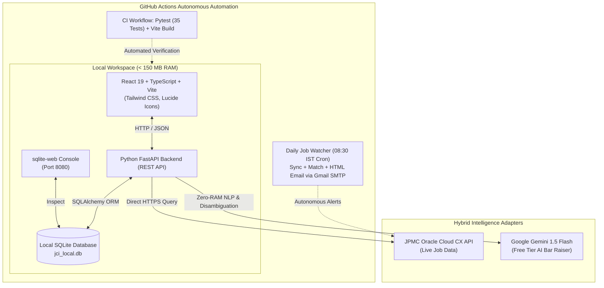

# JPMorgan Career Intelligence (JCI)

[](https://github.com/myself-moons/JP_Morgan_Career_Intelligence/actions/workflows/ci.yml)
[](https://github.com/myself-moons/JP_Morgan_Career_Intelligence/actions/workflows/jpmc_daily_job_sync.yml)


-003B57.svg)


**Version 2.0 | November 2026**

**JPMorgan Career Intelligence (JCI)** is a personal, local-first career intelligence and decision-support platform designed to analyze, track, and align career preparation against **JPMorgan Chase** technology, data governance, and analytics opportunities. 

Rather than relying on opaque ATS scoring or speculative hiring algorithms, JCI combines **deterministic NLP extraction**, **curated enterprise financial banking taxonomies**, and an **explainable AI rubric** to deliver traceable skill coverage, evidence-backed gap analysis, and autonomous live job synchronization.

---

## 🎯 What Problem JCI Solves

1. **Misleading Enterprise Job Titles:** Job titles in large investment banks often mask the actual functional domain. For instance, in our research baseline, *Data Analytics Associate* is strictly an Asset & Wealth Management FP&A accounting role requiring GAAP/IFRS, whereas *CR Portfolio Analytics* requires Commercial Real Estate credit risk models. JCI categorizes listings into functional **Role Families** (A, B, C) based on real responsibilities.
2. **Elimination of Black-Box ATS Scores:** Standard applicant tracking systems boil candidate fit down to an arbitrary single percentage that hides critical deficiencies. JCI evaluates fit across independent dimensions: **Technical Alignment**, **Domain/Governance Alignment**, **Seniority/Experience**, and **Formal Education Prerequisites**.
3. **Education vs. Skill Gap Isolation (BR-15):** Strict educational prerequisites (e.g. postgraduate finance degrees for Reference Data Analyst) are categorized as **Education/Eligibility Gaps** rather than learnable technical deficiencies, saving candidates from wasting time learning syntax when a formal degree is mandatory.
4. **Verbatim Traceability:** Every extracted skill and requirement is permanently linked to its immutable sentence snippet from the original job description.
5. **Low-Spec Hardware Accessibility:** Designed from the ground up to operate smoothly on resource-constrained client machines (e.g., 4.00 GB RAM, dual-core CPUs) under a strict **150 MB local RAM budget** using a zero-RAM cloud LLM adapter.

---

## ⚡ Key Capabilities & Delivered Modules

### 1. 🔄 Live Oracle Cloud Job Sync & Scheduled Watcher
- **Live JPMC API Integration (`job_sync.py`):** Directly queries JPMorgan Chase's live Oracle Cloud Candidate Experience (`CX_1001`) API.
- **Geographic Filtering & Cleansing:** Auto-filters Mumbai and Goregaon technology hubs, strips messy HTML, extracts structured sections, and assigns requisition codes (`JPMC-REQ-XX`).
- **Posting Date Provenance:** Preserves exact publication dates (`PostedDate`) and surfaces them across the UI and email briefings.
- **Autonomous Cloud Cron (`jpmc_daily_job_sync.yml`):** Runs daily at 08:30 IST via GitHub Actions, synchronizes new postings, evaluates fit against the candidate's active profile, compiles Markdown summaries, and dispatches executive HTML briefings via Gmail SMTP.

### 2. 📑 Multi-Resume Repository & In-Browser LaTeX Studio
- **Multi-Resume Management:** Store multiple tailored resumes (`ResumeDocument`) with instant active-profile switching.
- **PyMuPDF Document Extraction:** Automatic text extraction from PDF and LaTeX source files.
- **Live PDF Byte-Streaming:** View PDFs inline inside the browser without third-party extensions.
- **Syntax-Highlighted LaTeX Editor:** Edit resumes in-browser with real-time Overleaf-compatible `.tex` export.

### 3. 🤖 Explainable AI Bar Raiser & Anti-Quota Cache
- **3-Dimensional Evaluation (Gemini 1.5 Flash):** Evaluates fit against a structured rubric:
  - **Technical Alignment (45%):** Programming languages, frameworks, SQL/databases, cloud tools.
  - **Domain & Governance Alignment (35%):** JPMC risk controls, BCBS 239, Collibra, financial pipelines.
  - **Seniority & Experience (20%):** Years of experience and organizational scope.
- **Deterministic Offline Fallback:** If offline or if no API key is provided, the platform automatically falls back to deterministic taxonomy matching with zero disruption.
- **SHA-256 Anti-Hoarding Cache (`LLMEvaluation`):** Evaluations are fingerprinted with SHA-256 hashes of `(resume_text + job_description)`. Revisiting a job/resume pair results in zero network calls and zero cost.

### 4. 🏷️ Canonical Skill Taxonomy & Human-in-the-Loop Review (M3)
- **Enterprise Financial Taxonomy:** 35+ canonical skills across 5 core categories with 60+ curated alias mappings.
- **Regex Word-Boundary Extraction:** High-precision dictionary matching attaching verbatim source evidence sentences.
- **Interactive Review Screen (`/skills`):** Full human-in-the-loop review interface allowing users to approve (`Accepted`), reject (`Rejected`), reclassify requirement type, or register new custom aliases into SQLite.
- **Semantic Disambiguation (FR-42, TC-22):** Free-tier Gemini Flash assistant to resolve ambiguous extracted phrases in context.

### 5. 📊 Comparative Analytics Engine & Cross-Role Matrix (M4)
- **Active Denominator Exclusion ($N=10$, BR-06):** Unavailable listings (`JD unavailable`) are excluded from frequency denominators.
- **Distinct-Job Single Count Rule (BR-07, TC-11):** A skill mentioned multiple times in one JD counts at most once.
- **Role Family Segmentation:** Filter coverage across Family A (Governance/DQ), Family B (Analytics/AI), and Family C (Finance/Operations).
- **Cross-Role Matrix Grid (`/dashboard`, FR-16):** Full interactive grid comparing skills across all analysable jobs with Required vs. Preferred badges and click-to-inspect evidence modals (FR-15, FR-25).

### 6. 🔍 Interactive Web SQL Database Console
- Embedded web-based SQLite console (`sqlite-web`) on port `8080` for inspecting tables, schemas, relations, and executing ad-hoc queries.

---

## 🏛️ System Architecture



---

## 💼 Enterprise Data Analysis & Governance Mapping (For Resumes & Interviews)

This platform is architected to mirror the exact functional competencies evaluated in JPMorgan Chase data teams, including the **Chief Data Office (CDO)**, **Asset & Wealth Management Analytics (AWM)**, and **Corporate & Investment Bank (CIB)**:

| JPMC Data Role Competency | How JCI Implements It Under the Hood |
| :--- | :--- |
| **Data Quality (DQ) & Reconciliation Controls** *(Chief Data Office / CAO)* | • **Active Denominator Governance ($N=10$, BR-06):** Unavailable listings are excluded from frequency denominators so statistical percentages are never skewed.<br>• **Single-Count Constraint (BR-07, TC-11):** Deduplicates repeated mentions within a single listing to prevent frequency distortion.<br>• **Deduplication:** Hash keys and external job ID matching (`JPMC-REQ-XX`). |
| **Master Data Management (MDM) & Taxonomy** *(Data Governance / Metadata)* | • **Canonical Taxonomy Engine:** Standardizes 60+ raw aliases, abbreviations, and misspellings into 35+ canonical enterprise entities.<br>• **100% Data Lineage & Traceability:** Every extracted skill links permanently to immutable, verbatim sentence evidence snippets. |
| **ETL Pipeline & REST API Integration** *(Analytics Solution / Automation)* | • **Automated Extraction:** Ingests live job descriptions from JPMorgan Chase's Oracle Cloud REST API (`CX_1001`).<br>• **Data Normalization:** Parses unstructured HTML and multi-page PDFs into structured relational tables (SQLAlchemy + SQLite). |
| **Comparative & Exploratory Data Analysis (EDA)** *(Asset & Wealth Management / FP&A)* | • **Cross-Role Matrix & Distribution:** Computes distinct-job frequency percentages across 3 functional Role Families (Family A: Governance/DQ, Family B: Analytics/AI, Family C: Finance/Operations). |
| **Pipeline Orchestration & Alerting** *(Global Research Modernization)* | • **Automated Scheduled Execution:** GitHub Actions cron running daily at 08:30 IST to trigger sync pipelines, rank matches, and deliver executive HTML/Markdown digests via Gmail SMTP. |

---

## 📊 Role Families & Baseline Research Dataset

The foundational research dataset comprises **11 JPMorgan Chase job descriptions** grouped into three functional tracks:

| Role Family | Focus Area | Baseline Listings Included |
| :--- | :--- | :--- |
| **Family A** | **Data Management, Quality & Governance** | • CAO Chief Data Office - Data Management - Associate (3+ yrs)<br>• Chief Data Office - Data Quality - Business Analytics Associate (5+ yrs)<br>• JPMorgan Data Governance – Senior Associate *(Status: `JD unavailable`)* |
| **Family B** | **Analytics, Automation & AI** | • Applied AI and Data Science Specialist – Global Research (1–5 yrs)<br>• Analytics Solution - Associate (10+ yrs) *(Payments Finance automation)*<br>• Data Analytics Associate (5+ yrs) *(Asset & Wealth Management FP&A)*<br>• CR Portfolio Analytics - Associate (3+ yrs) *(Commercial Real Estate credit risk)* |
| **Family C** | **Finance, Credit & Operations** | • Reference Data Analyst *(Requires postgraduate qualification in finance)*<br>• Analyst - Project Finance & Infrastructure Credit Risk<br>• Corporate & Investment Bank Credit Risk Analyst<br>• Corporate Payment Sales - Analyst (2+ yrs) |

*Active Denominator ($N$):* **10 analysable listings** (the 1 unavailable listing is excluded from skill frequency denominators per BR-06).

---

## 🚀 Quickstart Guide

### Prerequisites
- **Python 3.12+**
- **Node.js 18+** & **npm**

### 1. Clone the Repository
```bash
git clone https://github.com/myself-moons/JP_Morgan_Career_Intelligence.git
cd JP_Morgan_Career_Intelligence
```

### 2. Backend Setup
```powershell
# Create virtual environment
python -m venv venv
.\venv\Scripts\Activate.ps1

# Install dependencies
pip install -r backend/requirements.txt

# Run complete test suite (35 automated tests)
pytest backend/tests -v

# Start FastAPI server (Port 8000)
python backend/run.py
```
*API Swagger Documentation is available at: `http://localhost:8000/docs`*

### 3. Frontend Setup
```powershell
# In a separate terminal
cd frontend
npm install
npm run dev
```
*Open `http://localhost:5173` to launch the React application.*

### 4. Optional Tools
```powershell
# Start Web Database Inspection Console (Port 8080)
python backend/app/core/db_console.py

# Manually trigger live JPMC job sync
python scripts/jpmc_job_watcher.py --limit 25 --min-score 50 --dry-run
```

---

## ⚙️ Environment Variables (`.env`)

Create a `.env` file in the project root:

```ini
# Server Configuration
JCI_HOST=127.0.0.1
JCI_PORT=8000
JCI_DB_CONSOLE_PORT=8080

# Optional: Google Gemini API (For AI Bar Raiser & Disambiguation)
GEMINI_API_KEY=your_gemini_api_key_here
GEMINI_MODEL=gemini-1.5-flash-latest

# Optional: Email Notifications (For local test runs of jpmc_job_watcher.py)
SMTP_USER=your_email@gmail.com
SMTP_PASSWORD=your_gmail_app_password
ALERT_EMAIL=destination_email@gmail.com
```

---

## 📂 Project Structure

```text
JP_Morgan_Career_Intelligence/
├── .docs/                          # Comprehensive specification suite (v2.0)
│   ├── phases.md                   # Master implementation roadmap & milestones
│   ├── GITHUB_WORKFLOWS_SETUP.md   # Cloud automation & secrets guide
│   ├── JCI_FRS.md                  # Functional Requirements Specification
│   ├── JCI_SRS.md                  # Software Requirements Specification
│   ├── JCI_Project_Overview.md     # Business rationale & analytical strategy
│   ├── Job_Listings.md             # Baseline 11-JD dataset with annotations
│   └── README.md                   # Documentation suite index
├── .github/workflows/              # Autonomous cloud automation
│   ├── ci.yml                      # Automated Pytest (35 tests) + Vite build
│   └── jpmc_daily_job_sync.yml     # Daily 08:30 IST job watcher & email dispatch
├── backend/                        # FastAPI Python backend
│   ├── app/
│   │   ├── api/                    # REST endpoints (analytics, jobs, resumes, taxonomy)
│   │   ├── core/                   # Config, database setup, seeds, DB console
│   │   ├── models/                 # SQLAlchemy ORM entities & Pydantic schemas
│   │   └── services/               # Analytics, parsing, live sync, LLM matcher, taxonomy
│   ├── tests/                      # Automated test suite (35 test cases)
│   └── requirements.txt            # Python dependencies
├── frontend/                       # React 19 + TypeScript frontend
│   ├── src/
│   │   ├── components/             # Reusable UI components & navigation
│   │   ├── pages/                  # Dashboard, JobLibrary, ResumeWorkspace, SkillAnalysis
│   │   └── services/               # Axios API client
│   └── package.json
├── resumes/                        # Multi-resume repository (PDF & LaTeX files)
├── scripts/                        # Automation scripts (jpmc_job_watcher.py)
├── phases.md                       # Master implementation roadmap (root copy)
└── README.md                       # Repository overview & quickstart
```

---

## 📖 Complete Documentation Suite

Detailed technical documentation is maintained in the [`.docs/`](file:///c:/Users/Manthan.waghela/Github_Repositories/JP_Morgan_Career_Intelligence/.docs) directory:

- [**Implementation Roadmap & Phases (`phases.md`)**](file:///c:/Users/Manthan.waghela/Github_Repositories/JP_Morgan_Career_Intelligence/.docs/phases.md)
- [**GitHub Workflows & Automation Setup (`GITHUB_WORKFLOWS_SETUP.md`)**](file:///c:/Users/Manthan.waghela/Github_Repositories/JP_Morgan_Career_Intelligence/.docs/GITHUB_WORKFLOWS_SETUP.md)
- [**Functional Requirements Specification (`JCI_FRS.md`)**](file:///c:/Users/Manthan.waghela/Github_Repositories/JP_Morgan_Career_Intelligence/.docs/JCI_FRS.md)
- [**Software Requirements Specification (`JCI_SRS.md`)**](file:///c:/Users/Manthan.waghela/Github_Repositories/JP_Morgan_Career_Intelligence/.docs/JCI_SRS.md)
- [**Project Overview & Rationale (`JCI_Project_Overview.md`)**](file:///c:/Users/Manthan.waghela/Github_Repositories/JP_Morgan_Career_Intelligence/.docs/JCI_Project_Overview.md)
- [**Baseline Job Listings Dataset (`Job_Listings.md`)**](file:///c:/Users/Manthan.waghela/Github_Repositories/JP_Morgan_Career_Intelligence/.docs/Job_Listings.md)
- [**Plan Review Findings (`JCI_Plan_Review.md`)**](file:///c:/Users/Manthan.waghela/Github_Repositories/JP_Morgan_Career_Intelligence/.docs/JCI_Plan_Review.md)

---

## ⚖️ License & Ethical Stance

Developed strictly for **personal research, career planning, and education gap analysis**. This project does not circumvent access controls, violate terms of service, or guarantee employment outcomes. All JPMorgan Chase trademarks and job descriptions are property of JPMorgan Chase & Co.
